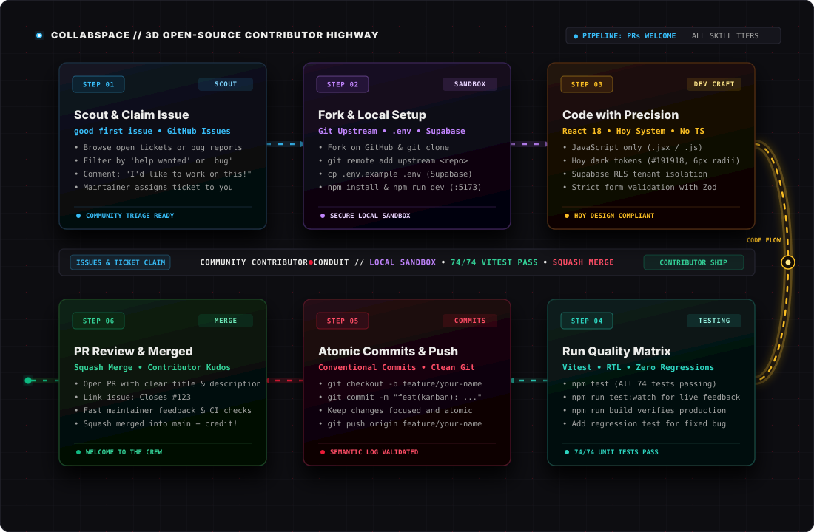

# Contributing to CollabSpace 🤝

<div align="center">

[](LICENSE)
[](https://github.com/roshangowdas/CollabSpace/pulls)
[](https://github.com/roshangowdas/CollabSpace/issues?q=is%3Aissue+is%3Aopen+label%3A%22good+first+issue%22)
[-emerald.svg?style=for-the-badge&logo=vitest&logoColor=white&color=10b981)](src/test)
[](tailwind.config.js)

<br/>

```
╔════════════════════════════════════════════════════════════════════════════════════════╗
║   SYS_STATUS // OPEN-SOURCE PIPELINE ONLINE                                            ║
║   Every pull request shapes the future of real-time SaaS. Welcome to the crew! 🚀      ║
╚════════════════════════════════════════════════════════════════════════════════════════╝
```

<p align="center">
  <b>CollabSpace</b> is an open-source, production-grade real-time team collaboration SaaS built with<br/>
  <b>React 18, Vite, Supabase, Tailwind CSS, and the Hoy Design System</b>.
</p>

[Browse Good First Issues](https://github.com/roshangowdas/CollabSpace/issues) • [Report a Bug](https://github.com/roshangowdas/CollabSpace/issues/new?template=bug_report.md) • [Propose an Idea](https://github.com/roshangowdas/CollabSpace/discussions) • [Join Maintainers](mailto:0243roshan@gmail.com)

</div>

---

## 🌐 3D Interactive Open-Source Contributor Pipeline

Explore the interactive 3D pipeline below illustrating the exact contributor journey from scouting tickets to the production squash-merge:

<div align="center">
<sub>Click any stage below to jump directly into interactive commands and architecture specifications</sub>

<br/><br/>

<a href="#-interactive-contributor-stages-click-to-inspect">
  
</a>

</div>

<br/>

<table align="center" width="100%">
  <tr align="center">
    <td><a href="#-step-01-scout--claim-an-issue"><b>🔍 STEP 01</b><br/>Scout &amp; Claim</a></td>
    <td><a href="#-step-02-fork-clone--local-sandbox"><b>💻 STEP 02</b><br/>Fork &amp; Sandbox</a></td>
    <td><a href="#-step-03-precision-craft--hoy-architecture"><b>⚡ STEP 03</b><br/>Craft &amp; Code</a></td>
    <td><a href="#-step-04-automated-quality-matrix--tests"><b>🧪 STEP 04</b><br/>Quality Matrix</a></td>
    <td><a href="#-step-05-atomic-commits--push"><b>📦 STEP 05</b><br/>Commit &amp; Push</a></td>
    <td><a href="#-step-06-pr-review--hall-of-fame-merge"><b>🎉 STEP 06</b><br/>Review &amp; Ship</a></td>
  </tr>
</table>

---

## 📑 Quick Navigation

- [📜 Code of Conduct](#-code-of-conduct)
- [🎯 Contributor Roles & Superpowers](#-contributor-roles--superpowers)
- [🚀 Interactive Contributor Stages (Click to Inspect)](#-interactive-contributor-stages-click-to-inspect)
  - [🔍 Step 01: Scout & Claim an Issue](#-step-01-scout--claim-an-issue)
  - [💻 Step 02: Fork, Clone & Local Sandbox](#-step-02-fork-clone--local-sandbox)
  - [⚡ Step 03: Precision Craft & Hoy Architecture](#-step-03-precision-craft--hoy-architecture)
  - [🧪 Step 04: Automated Quality Matrix & Tests](#-step-04-automated-quality-matrix--tests)
  - [📦 Step 05: Atomic Commits & Push](#-step-05-atomic-commits--push)
  - [🎉 Step 06: PR Review & Hall of Fame Merge](#-step-06-pr-review--hall-of-fame-merge)
- [📐 Architectural Spec Flowchart](#-architectural-spec-flowchart)
- [✅ Pre-Flight Pull Request Checklist](#-pre-flight-pull-request-checklist)
- [💬 Community & Maintainer Beacon](#-community--maintainer-beacon)

---

## 📜 Code of Conduct

We are committed to providing a welcoming, inclusive, and harassment-free community. When participating in discussions, issue triage, code reviews, or pull requests:

- **Empathy First**: Treat every contributor with kindness, curiosity, and respect regardless of experience level.
- **Constructive Code Reviews**: Critique architectures and code patterns constructively—never attack people.
- **Community Stewardship**: Help newcomers find their footing, mentor junior devs, and foster collaboration.

---

## 🎯 Contributor Roles & Superpowers

Find the role that best matches what you want to build:

| Superpower | What You Build & Shape | Recommended Labels |
| :--- | :--- | :--- |
| 🎨 **Frontend Craftsman** | Build modular React views, Tailwind components, Lucide icons, and responsive layouts. | `frontend`, `ui/ux`, `good first issue` |
| ⚡ **Real-Time Specialist** | Work with Supabase Realtime WebSockets, presence pills, typing indicators, and Yjs CRDTs. | `realtime`, `crdt`, `websockets` |
| 🛡️ **Backend & RLS Guardian** | Author PostgreSQL migrations, Supabase Row-Level Security (RLS) policies, and RPC functions. | `database`, `security`, `backend` |
| 🧪 **QA & Test Automator** | Expand Vitest unit suites, mock edge cases, and author Playwright end-to-end regression tests. | `testing`, `qa`, `vitest` |
| 📖 **Docs & DevRel** | Polish architectural diagrams, setup guides, code comments, and contributor walkthroughs. | `documentation`, `devrel` |

---

## 🚀 Interactive Contributor Stages (Click to Inspect)

<!-- Collapsible Stage 01 -->
<details open>
<summary><h3>🔍 Step 01: Scout &amp; Claim an Issue</h3></summary>
<br/>

> **Find your target task and reserve it to avoid duplicated effort.**

1. Head over to our [GitHub Issues](https://github.com/roshangowdas/CollabSpace/issues) tab.
2. Filter issues by tags:
   - `good first issue`: Accessible tasks ideal for new contributors.
   - `help wanted`: High-impact features looking for community help.
   - `bug`: Confirmed defects needing reproduction and fix.
   - `enhancement`: New platform features and UI refinements.
3. **Claim the issue**: Drop a friendly comment on the ticket:
   > *"Hi team! I'd love to work on this issue. Please assign it to me!"*
4. A maintainer will assign the issue to you so everyone knows you are actively working on it.

#### Found a Bug? Report It Cleanly:
If you discovered a bug, open a new ticket with:
- Clear title: `[Bug]: Chat message input overflows on mobile viewport`
- Reproducible steps: `1. Open chat on mobile. 2. Type long string. 3. Observe horizontal scrollbar.`
- Expected vs. Actual behavior
- Browser, OS, and screenshots / screen recordings.

</details>

<!-- Collapsible Stage 02 -->
<details>
<summary><h3>💻 Step 02: Fork, Clone &amp; Local Sandbox</h3></summary>
<br/>

> **Get CollabSpace running smoothly on your local machine in under 2 minutes.**

#### 1. Fork and Clone
```bash
# 1. Click 'Fork' on https://github.com/roshangowdas/CollabSpace
# 2. Clone your personal fork:
git clone https://github.com/<YOUR_GITHUB_USERNAME>/CollabSpace.git
cd CollabSpace

# 3. Add upstream remote to stay synchronized:
git remote add upstream https://github.com/roshangowdas/CollabSpace.git
```

#### 2. Install Packages
```bash
npm install
```

#### 3. Configure Local Environment
```bash
# Copy template environment file:
cp .env.example .env
```
Fill in your Supabase project parameters:
```env
VITE_SUPABASE_URL=https://your-project.supabase.co
VITE_SUPABASE_ANON_KEY=your-anon-key-here
VITE_HOCUSPOCUS_URL=ws://localhost:1234
```

> ⚠️ **CRITICAL SECURITY NOTE**: Never commit `.env` or paste `service_role` private keys into the frontend code! Only public `VITE_` variables are allowed on the client.

#### 4. Launch the Dev Server
```bash
npm run dev
```
Open [http://localhost:5173](http://localhost:5173) in your browser.

*(Optional)* If you are working on real-time collaborative docs, boot the CRDT server:
```bash
npm run server
```

</details>

<!-- Collapsible Stage 03 -->
<details>
<summary><h3>⚡ Step 03: Precision Craft &amp; Hoy Architecture</h3></summary>
<br/>

> **Follow our clean engineering guidelines and Hoy Design System tokens.**

#### Strict Architectural Rules

| Rule | Guideline |
| :--- | :--- |
| **Language** | **JavaScript ONLY** (`.jsx` and `.js`). Never use TypeScript. |
| **Components** | Functional components and hooks only. Never build class components. |
| **No Monoliths** | Keep files under 400 lines. Separate UI views, services, hooks, and contexts. |
| **Design System** | Follow **Hoy Design System** tokens: dark obsidian background (`#191918` / `#120d0f`), card surface (`#222221`), light text (`#ECECEA`), muted text (`#A5A5A4`), and `6px` radii. |
| **Database & RLS** | Every table must enforce Supabase Row-Level Security (`workspace_id` tenant isolation). |
| **Zero Trust** | Never trust frontend-only role checks. Always pair UI gating with backend RLS. |
| **Forms** | Always validate input schemas using `zod` and `react-hook-form`. Include loading, error, and empty states. |

#### Directory Hierarchy
```
src/
├── components/          # Modular UI components
│   ├── admin/           # Super Admin portal views (/admin)
│   ├── chat/            # Real-time threaded chat & reactions
│   ├── docs/            # Tiptap + Yjs CRDT document editor
│   ├── kanban/          # Drag-and-drop task boards (@dnd-kit)
│   ├── presence/        # Live collaborator avatars & presence mesh
│   ├── profile/         # User profile views & avatar modals
│   ├── ui/              # Reusable atomic buttons, cards, dialogs, inputs
│   └── whiteboard/      # Infinite canvas brainstorming
├── contexts/            # React Context providers (Auth, Workspace, Presence)
├── hooks/               # Custom reusable React hooks
├── integrations/        # Supabase client, queries, and authUtils
├── lib/                 # Utility helpers, classnames (cn)
├── services/            # Supabase API services, rate limiters, security guards
├── test/                # Vitest unit test suites (74 tests passing)
└── utils/               # Pure math algorithms and validators
```

</details>

<!-- Collapsible Stage 04 -->
<details>
<summary><h3>🧪 Step 04: Automated Quality Matrix &amp; Tests</h3></summary>
<br/>

> **We maintain a strict 100% passing test policy. Zero broken features, zero flakiness.**

#### Test Commands
```bash
# 1. Run full unit test suite with Vitest
npm test

# 2. Run tests in interactive watch mode during development
npm run test:watch

# 3. Test production Vite bundle compilation
npm run build

# 4. (Optional) Run Playwright end-to-end tests
npm run test:e2e
```

#### Test Suite Standards
- **74/74 Tests**: Existing tests must never be skipped or broken.
- **Bug Fixes**: When fixing a bug, write a regression unit test in `src/test/` to ensure the bug never recurs.
- **New Features**: Every new service or utility function should have corresponding unit tests verifying happy and failure paths.

</details>

<!-- Collapsible Stage 05 -->
<details>
<summary><h3>📦 Step 05: Atomic Commits &amp; Push</h3></summary>
<br/>

> **Clean Git history makes reviewing and merging effortless.**

#### 1. Create a Topic Branch
Always branch off the latest upstream `main`:
```bash
git checkout main
git pull upstream main
git checkout -b feature/kanban-card-tags
```

#### 2. Commit Using Conventional Commits
Use semantic commit messages:
```bash
git add .
git commit -m "feat(kanban): add color-coded tag pills to task cards"
```

Common commit types:
- `feat`: A new user-facing feature
- `fix`: A bug fix
- `docs`: Documentation-only updates
- `style`: Formatting, whitespace (no logic change)
- `refactor`: Restructuring code without adding features or fixing bugs
- `test`: Adding or correcting tests
- `perf`: Performance optimizations
- `chore`: Build scripts, dependencies, config updates

#### 3. Push to Your Fork
```bash
git push origin feature/kanban-card-tags
```

</details>

<!-- Collapsible Stage 06 -->
<details>
<summary><h3>🎉 Step 06: PR Review &amp; Hall of Fame Merge</h3></summary>
<br/>

> **Submit your Pull Request, collaborate on review, and get merged into main!**

1. Go to [roshangowdas/CollabSpace](https://github.com/roshangowdas/CollabSpace) on GitHub.
2. Click the green **"Compare & pull request"** button.
3. Fill out the PR template:
   - **Summary**: Concise bullet points explaining what was changed.
   - **Linked Issue**: Add `Closes #123` or `Fixes #45` so GitHub automatically links and closes the ticket.
   - **Visual Proof**: Attach screenshots or a GIF for UI changes!
4. Submit the PR! Maintainers will review your code promptly, run automated CI checks, and approve it.
5. Your PR will be **Squash Merged**, and your GitHub profile will be permanently credited as an official CollabSpace contributor! 🏆

</details>

---

## 📐 Architectural Spec Flowchart

Below is the automated lifecycle of how community contributions flow into production:

```mermaid
flowchart LR
  subgraph Community ["Community Contributor Space"]
    Issue["🎯 GitHub Issues<br/>(good first issue)"]
    Fork["🍴 Fork & Clone<br/>(Local Dev Server)"]
    Code["💻 Code & Design<br/>(Hoy System Tokens)"]
    Vitest["🧪 Vitest Matrix<br/>(74/74 Unit Tests)"]
  end

  subgraph ReviewGate ["Automated CI & Peer Review"]
    PR["📬 Pull Request<br/>(Closes #Issue)"]
    CI["⚙️ GitHub Actions CI<br/>(Lint, Build, Test)"]
    Review["👀 Maintainer Review<br/>(Constructive Feedback)"]
  end

  subgraph Ship ["Production Delivery"]
    Squash["🔀 Squash & Merge<br/>(main branch)"]
    Deploy["🚀 Vercel / Netlify<br/>(Live Production Ship)"]
    Fame["🏆 Contributor Hall of Fame<br/>(Permanent Kudos)"]
  end

  Issue --> Fork --> Code --> Vitest --> PR
  PR --> CI --> Review
  Review -->|Approved| Squash --> Deploy --> Fame
  Review -.->|Requested Changes| Code
```



---

## ✅ Pre-Flight Pull Request Checklist

Before submitting your PR, run through this quick checklist:

- [ ] **JavaScript Only**: No TypeScript files (`.ts` / `.tsx`) introduced.
- [ ] **Hoy Design System**: Matches dark palette (`#191918`, `#222221`), `6px` radii, and responsive layout.
- [ ] **100% Tests Pass**: Ran `npm test` and all 74 unit tests passed without errors.
- [ ] **Production Build**: Ran `npm run build` and Vite compiled successfully without warnings.
- [ ] **No Secrets Leaked**: Zero API keys, passwords, or `.env` files in git diff (`git diff`).
- [ ] **Supabase Security**: Verified Row Level Security (RLS) policies if database tables or queries were modified.
- [ ] **Clean Commits**: Commit message follows Conventional Commits format (`feat(...)`, `fix(...)`).
- [ ] **Screenshots Attached**: Included screenshots / GIFs in the PR description for visual UI changes.

---

## 💬 Community & Maintainer Beacon

Have a question, need architectural feedback, or stuck on setup? We are here to help!

- 🐛 **Issue Tracker**: [github.com/roshangowdas/CollabSpace/issues](https://github.com/roshangowdas/CollabSpace/issues)
- 💡 **Discussions**: [github.com/roshangowdas/CollabSpace/discussions](https://github.com/roshangowdas/CollabSpace/discussions)
- 💼 **LinkedIn**: [Roshan Gowda S](https://www.linkedin.com/in/roshan-gowda-s-378343283/)
- ✉️ **Maintainer Email**: `0243roshan@gmail.com`

<br/>

<div align="center">
  <sub>Built with ❤️ by Roshan Gowda S and the open-source community.</sub>
</div>
