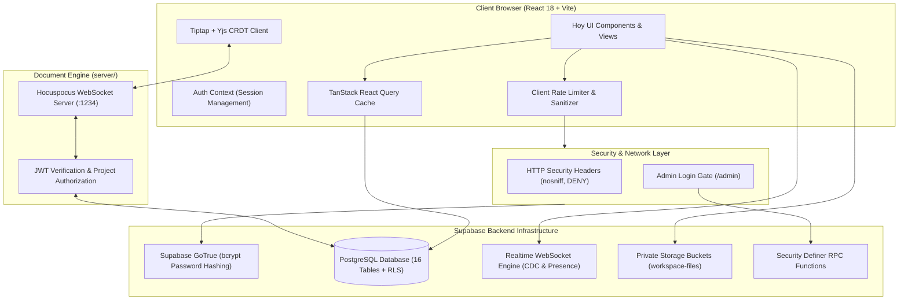

<div align="center">

  <!-- Dynamic 3D Capsule Header Banner -->
  

  <p align="center">
    <strong>A high-velocity, real-time team collaboration SaaS platform.</strong><br />
    Sprint Kanban, CRDT Collaborative Docs, Infinite Canvas Whiteboards, Real-Time Project Chat, and Enterprise RBAC.
  </p>

  <!-- Premium 3D Badges Grid -->
  <p align="center">
    <a href="#test-suite-status"></a>
    <a href="#security-audit-status"></a>
    <a href="#tech-stack"></a>
    <a href="#database--real-time-infrastructure"></a>
    <a href="#design-system"></a>
    
  </p>

  <!-- Interactive Quick Navigation Bar -->
  <p align="center">
    <a href="#-core-platform-modules"><b>Explore Modules</b></a> •
    <a href="#-system-architecture"><b>Architecture</b></a> •
    <a href="#-quick-start"><b>Quick Start</b></a> •
    <a href="#-security--data-isolation"><b>Security & RLS</b></a> •
    <a href="#-interactive-design-system"><b>Design System</b></a> •
    <a href="#-verification--testing"><b>Test Matrix</b></a>
  </p>

</div>

---

## ⚡ Tech Stack & Interactive Ecosystem

<div align="center">
  
</div>

<br />

| Layer | Technologies & Libraries | Key Highlights |
| :--- | :--- | :--- |
| **Core Frontend** | React 18, Vite 6, JavaScript (ESM) | Ultra-fast HMR, componentized architecture, zero TypeScript lock-in |
| **Styling & Theme** | Tailwind CSS 3.4, Hoy Design System | Warm dark (`#191918`), warm cream (`#ECECEA`), 6px micro-radii |
| **Icons & UI** | Lucide React, cva, framer-motion | Responsive, accessible, minimal animations, clean typography |
| **Real-Time Data** | Supabase Realtime, Hocuspocus CRDT | WebSockets, live user presence, typing indicators, conflict-free merges |
| **State & Cache** | TanStack React Query v5 | Server state caching, optimistic updates, background hydration |
| **Forms & Security** | React Hook Form, Zod, DOMPurify logic | Sliding-window rate limiting, input sanitization, strict XSS protection |
| **Testing** | Vitest, React Testing Library, Playwright | 74 unit tests, 17 security tests, 30 multi-viewport E2E tests |

---

## 💎 Core Platform Modules

Click any interactive module below to reveal its architectural specifications, database tables, and real-time workflows:

<details open>
<summary><h3>📌 1. Sprint Kanban Boards & Backlog Management</h3></summary>

> **High-velocity sprint tracker powered by `@dnd-kit` and Supabase Realtime.**

- **Monotonic Fractional Positioning**: Re-order cards seamlessly across columns without full-table index collisions.
- **Optimistic UI with Rollback**: Instant drag-and-drop feedback with automatic state snapshot recovery if network fails.
- **Multi-Factor Filtering**: Live instant search, project attribution, priority flags (Low, Medium, High, Urgent), and status columns (`Todo`, `In Progress`, `In Review`, `Completed`).
- **Slide-Over Task Drawer**: Deep dive into subtasks, attachments, and real-time comment threads.

```
[Backlog / Todo] ───( Drag & Drop )───► [In Progress] ───► [In Review] ───► [Completed]
        ▲                                                                           │
        └─────────────────────── Realtime Sync (PostgreSQL CDC) ────────────────────┘
```
</details>

<details>
<summary><h3>💬 2. Real-Time Project Chat & Threaded Messaging</h3></summary>

> **Dedicated project channels, file attachments, and live availability.**

- **Threaded Conversations**: Quoted parent replies, member mentions with `@username` autocomplete, and date dividers.
- **Secure File Attachments**: Upload and preview code files, mockups, images, and documents directly in chat.
- **Author-Only Governance**: Authors can edit or delete their own messages; workspace admins retain supervisory moderation.
- **Live Typing Awareness**: Ephemeral typing badges indicating who is actively typing in the channel.
</details>

<details>
<summary><h3>📝 3. Collaborative Document Editor (CRDT)</h3></summary>

> **Real-time rich text editing powered by Tiptap, Yjs CRDTs, and a dedicated WebSocket server.**

- **Conflict-Free Merging**: Mathematical Yjs CRDT state merging guarantees zero text collisions during simultaneous multi-user typing.
- **Collaborator Cursors & Labels**: Real-time peer cursors, selection highlights, and user presence pills.
- **Dedicated Hocuspocus Server**: Standalone Node.js WebSocket engine (`server/index.js`) authenticating incoming tokens with Supabase.
- **Document Versioning**: Automatic debounced snapshots saved directly to PostgreSQL.
</details>

<details>
<summary><h3>🎨 4. Collaborative Brainstorming Canvas (Whiteboard)</h3></summary>

> **Infinite zoom-and-pan whiteboard canvas for design sprints and architecture wireframing.**

- **Interactive Canvas Elements**: Color-coded sticky notes, geometric shapes (rectangles, circles), directional connecting arrows, and freehand drawing pens.
- **Operational Synchronization**: Broadcasts delta changes via Supabase Realtime channels avoiding destructive full-board overwrites.
- **Participant Presence Rings**: Visual peer indicators showing active collaborators in the canvas.
- **Smooth Navigation**: Pan effortlessly using Spacebar or Hand tool; zoom from 0.25x to 3.0x with smooth focal centering.
</details>

<details>
<summary><h3>📊 5. Team Velocity & Analytics Dashboard</h3></summary>

> **Real-time statistical calculations and dynamic charting with Recharts.**

- **Dynamic Metric Calculations**: Zero hardcoded numbers—every metric is computed dynamically from real database records.
- **Project Completion Breakdown**: Stacked bar charts showcasing tasks completed vs. remaining across projects.
- **Weekly Velocity Trends**: Area charts illustrating creation vs. completion velocity over time.
- **Priority & Member Load**: Donut priority distributions and member workload allocation segment bars.
</details>

<details>
<summary><h3>🛡️ 6. Super Admin Portal & Workspace Governance</h3></summary>

> **Workspace-level administration console restricted exclusively to verified administrators.**

- **Direct URL Security Gate**: Accessible exclusively at `/admin`, guarded by single super admin credentials (`0243roshan@gmail.com`).
- **Sliding-Window Rate Limiting**: Max 5 attempts per minute to block brute-force credential stuffing.
- **6 Core Management Suites**:
  1. **Overview**: Total member counts, task velocity, active projects, and upcoming deadlines.
  2. **Members**: Role modification, member directory, joining dates, and removal controls.
  3. **Projects**: Workspace project CRUD, status badges, and deletion confirmations.
  4. **Tasks**: Comprehensive task search, overdue flags, and assignee attribution.
  5. **Activity**: Chronological audit trail of member joins, role changes, and task completions.
  6. **Settings**: Workspace branding, invitation policies, and Owner-only danger zone deletion.
</details>

---

## 🏛️ System Architecture



---

## 🔒 Security & Data Isolation

CollabSpace is built with a **Security-First Architecture** verified across 17 audit domains:

```
┌────────────────────────────────────────────────────────────────────────┐
│                      SECURITY ARCHITECTURE CHECKLIST                   │
├────────────────────────────────────────────────────────────────────────┤
│  ✔  Zero Service Role Leakage    │ Client bundle contains anon keys only │
│  ✔  Strict .gitignore Exclusion  │ .env, .env.* never tracked in Git   │
│  ✔  Row Level Security (RLS)     │ Enforced across all 16 tables       │
│  ✔  Private Storage Buckets      │ public = false on all storage files │
│  ✔  Server Password Hashing      │ bcrypt / argon2id with random salts │
│  ✔  Sliding-Window Rate Limits   │ Sign-in, sign-up, admin login, reset│
│  ✔  Input Sanitization           │ Automatic tag stripping & XSS block │
│  ✔  HTTP Security Headers        │ nosniff, DENY, strict-origin        │
│  ✔  Anti-Self-Promotion Checks   │ Database triggers block role spoof  │
└────────────────────────────────────────────────────────────────────────┘
```

<details>
<summary><b>View Database Row Level Security (RLS) Coverage Matrix</b></summary>

| Application Table | RLS Status | Read Policy | Write Policy |
| :--- | :---: | :--- | :--- |
| `public.profiles` | **ACTIVE** | Public read for registered users | User only (`auth.uid() = id`) |
| `public.workspaces` | **ACTIVE** | Workspace members only | Owners & Admins only |
| `public.workspace_members` | **ACTIVE** | Workspace members only | Owners & Admins only |
| `public.workspace_invitations`| **ACTIVE** | Workspace members only | Owners & Admins only |
| `public.projects` | **ACTIVE** | Workspace members only | Workspace members only |
| `public.project_members` | **ACTIVE** | Project members only | Project Admins only |
| `public.tasks` | **ACTIVE** | Project members only | Assigned members & Admins |
| `public.task_comments` | **ACTIVE** | Project members only | Author only edit/delete |
| `public.attachments` | **ACTIVE** | Workspace members only | Uploader only delete |
| `public.activity_logs` | **ACTIVE** | Workspace members only | Read-only automated trigger |
| `public.notifications` | **ACTIVE** | Recipient only (`auth.uid() = user_id`) | System trigger only |
| `public.messages` | **ACTIVE** | Channel members only | Author only edit/delete |
| `public.documents` | **ACTIVE** | Project members only | Project members only |
| `public.document_updates` | **ACTIVE** | Project members only | Collaborative sync only |
| `public.whiteboards` | **ACTIVE** | Workspace members only | Workspace members only |
| `public.whiteboard_elements` | **ACTIVE** | Workspace members only | Workspace members only |

</details>

---

## 🎨 Interactive Design System (Hoy Tokens)

CollabSpace implements the minimalist, conversion-focused **Hoy Design System** (`design-system-hoy`):

<div align="center">

```
  ┌─────────────────┬─────────────────┬─────────────────┬─────────────────┐
  │  Background     │  Text Primary   │  Text Secondary │  Text Light     │
  │  #191918 (Dark) │  #585855        │  #73736F        │  #ECECEA        │
  └─────────────────┴─────────────────┴─────────────────┴─────────────────┘
```

</div>

- **Micro-Radius Scale**: `sm: 1px` • `md: 5px` • `lg: 6px` • `full: 99px` (No oversized generic cards).
- **Typography Font Stack**: `system-ui, ui-rounded, 'Times New Roman', sans-serif`.
- **Typographic Scale**: `xs: 11px` • `sm: 13px` • `base: 15px` • `lg: 16px` • `xl: 21px` • `2xl: 23px` • `3xl: 25px` • `4xl: 29px`.
- **Multi-Tier Elevation**: Custom Hoy shadow curves from `shadow-sm` up to `shadow-21`.

---

## 🚀 Quick Start

### 1. Prerequisites
- **Node.js**: v18.0.0 or later (Node.js 20+ recommended)
- **npm**: v9.0.0 or later

### 2. Clone and Install

```bash
# Clone the repository
git clone https://github.com/roshangowdas/CollabSpace.git
cd CollabSpace

# Install project dependencies
npm install
```

### 3. Configure Environment Variables

Copy the template and provide your Supabase publishable credentials:

```bash
cp .env.example .env
```

Edit `.env`:

```env
# Supabase Public Configuration (Dashboard > Project Settings > API)
VITE_SUPABASE_URL=https://your-project.supabase.co
VITE_SUPABASE_ANON_KEY=your-supabase-publishable-anon-key

# Application Settings
VITE_APP_NAME=CollabSpace
VITE_APP_ENV=development
VITE_DEBUG_MODE=true

# Single Super Admin Access
VITE_SUPER_ADMIN_EMAIL=0243roshan@gmail.com
```

### 4. Run Development Servers

```bash
# Launch the React + Vite frontend (http://localhost:5173)
npm run dev

# (Optional) Launch the Hocuspocus Collaborative Document Server
npm run server
```

---

## 🧪 Verification & Testing

CollabSpace includes a robust, automated test suite covering unit tests, security audits, and multi-viewport end-to-end flows:

```bash
# Run unit and integration tests (74 passing tests)
npm test

# Run the 17-point automated security audit
node scripts/test_security_audit.js

# Run Playwright end-to-end tests
npm run test:e2e

# Build production bundle with zero compilation errors
npm run build
```

<details>
<summary><b>View Automated Test Suite Breakdown</b></summary>

```
Test Files  9 passed (9)
     Tests  74 passed (74)
   Results  100% Passing

 ✓ src/test/collaboration.test.js  (12 tests) - CRDT document merging & presence
 ✓ src/test/tasks.test.js          (11 tests) - Task CRUD & status transitions
 ✓ src/test/files.test.js          (8 tests)  - File validation & upload flows
 ✓ src/test/workspaces.test.js     (8 tests)  - Multi-tenant workspace RBAC
 ✓ src/test/ui-components.test.jsx (8 tests)  - Button, Input, Modal, Badge
 ✓ src/test/projects.test.js       (7 tests)  - Project lifecycle & member assign
 ✓ src/test/analytics.test.js      (7 tests)  - Real-time KPI calculations
 ✓ src/test/auth.test.js           (7 tests)  - Rate limiting & input handling
 ✓ src/test/realtime.test.js       (6 tests)  - Presence & WebSocket events
```

</details>

---

## 🗺️ Key Routes Map

| Route Path | View Purpose | Protection Level |
| :--- | :--- | :---: |
| `/` | Interactive SaaS Landing Page & Pricing | **Public** |
| `/login` | User Authentication Portal | **Public Only** |
| `/register` | Team Sign-Up Flow | **Public Only** |
| `/dashboard` | Authenticated User Overview Hub | **Protected** |
| `/admin` | Dedicated Single Super Admin Portal | **Super Admin Gate** |
| `/projects` | Workspace Projects & Deadlines | **Protected** |
| `/tasks` | Interactive Drag-and-Drop Kanban Board | **Protected** |
| `/chat` | Real-Time Project Messaging Channels | **Protected** |
| `/docs` | Real-Time CRDT Collaborative Docs | **Protected** |
| `/whiteboards` | Collaborative Brainstorming Canvas | **Protected** |
| `/analytics` | Dynamic KPI Charts & Member Workloads | **Protected** |
| `/settings` | User Profile & Security Configuration | **Protected** |
| `/privacy`, `/terms` | Legal Policies & DPDP Act Compliance | **Public** |

---

## 📄 License & Attribution

Distributed under the **MIT License**. See `LICENSE` for more information.

<div align="center">
  <sub>Built with precision for high-velocity software teams. Designed with the Hoy aesthetic.</sub>
</div>
