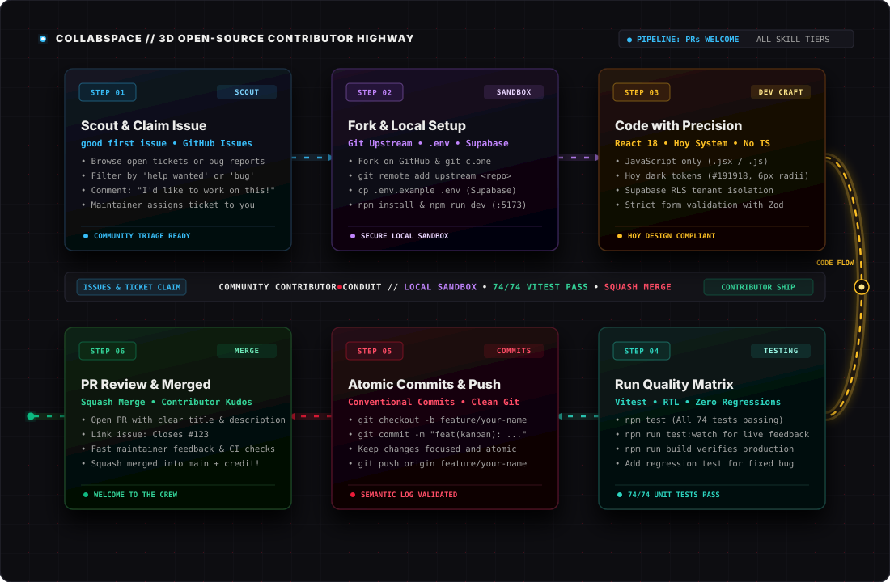

# Contributing to CollabSpace 🤝

<div align="center">

[](LICENSE)
[](https://github.com/roshangowdas/CollabSpace/pulls)
[](https://github.com/roshangowdas/CollabSpace/issues?q=is%3Aissue+is%3Aopen+label%3A%22good+first+issue%22)
[-emerald.svg?style=for-the-badge&logo=vitest&logoColor=white&color=10b981)](src/test)

<br/>

```
╔════════════════════════════════════════════════════════════════════════════════════════╗
║   COLLABSPACE OPEN-SOURCE // ALL COMMUNITY CONTRIBUTORS WELCOME                        ║
║   Find an issue ──► Claim it ──► Code & Test ──► Submit PR ──► Get Merged! 🚀          ║
╚════════════════════════════════════════════════════════════════════════════════════════╝
```

<p align="center">
  Welcome to <b>CollabSpace</b>! We are a community-driven open-source project. Whether you're a first-time contributor or an experienced engineer, we'd love your help solving issues, polishing features, and submitting pull requests.
</p>

> 📘 **Looking for comprehensive architecture rules, Supabase RLS policies, and code standards?**  
> Check out the complete [**CONTRIBUTING.md**](CONTRIBUTING.md) guide!

</div>

---

## 🌐 3D Interactive Open-Source Contributor Pipeline

<div align="center">
<sub>Click any stage below to inspect commands and architecture details</sub>

<br/><br/>

<a href="CONTRIBUTING.md#-interactive-contributor-stages-click-to-inspect">
  
</a>

</div>

<br/>

<table align="center" width="100%">
  <tr align="center">
    <td><a href="#1-find--claim-an-issue"><b>🔍 STEP 01</b><br/>Find &amp; Claim</a></td>
    <td><a href="#2-fork-clone--configure-sandbox"><b>💻 STEP 02</b><br/>Fork &amp; Sandbox</a></td>
    <td><a href="#3-branch-code--design"><b>⚡ STEP 03</b><br/>Code &amp; Design</a></td>
    <td><a href="#4-verify-with-vitest"><b>🧪 STEP 04</b><br/>Verify Tests</a></td>
    <td><a href="#5-commit-and-send-pr"><b>🎉 STEP 05</b><br/>Commit &amp; PR</a></td>
  </tr>
</table>

---

## ⚡ Quick 5-Step Contribution Guide (Click to Inspect)

<details open>
<summary><h3>1. Find &amp; Claim an Issue</h3></summary>
<br/>

- Head to our [GitHub Issues](https://github.com/roshangowdas/CollabSpace/issues) tab.
- Look for tags like:
  - `good first issue`: Perfect for your first open-source PR!
  - `help wanted`: Features where community help is warmly requested.
  - `bug`: Reproducible glitches waiting for a fix.
- Claim it: Drop a comment on the issue: *"I'd like to work on this! Please assign it to me."*
- Found a bug? Open a new issue with steps to reproduce and screenshots.

</details>

<details>
<summary><h3>2. Fork, Clone &amp; Configure Sandbox</h3></summary>
<br/>

```bash
# 1. Fork the repo on GitHub, then clone your personal fork:
git clone https://github.com/<YOUR_USERNAME>/CollabSpace.git
cd CollabSpace

# 2. Add upstream remote to stay synchronized:
git remote add upstream https://github.com/roshangowdas/CollabSpace.git

# 3. Install dependencies:
npm install

# 4. Set up environment:
cp .env.example .env
# Open .env and add your Supabase project keys

# 5. Boot the Vite dev server:
npm run dev
```

</details>

<details>
<summary><h3>3. Branch, Code &amp; Design</h3></summary>
<br/>

```bash
# Always branch off the latest main:
git checkout main
git pull upstream main
git checkout -b feature/your-feature-name
```

#### Core Craftsmanship Rules:
- **Language**: **JavaScript only** (`.jsx` / `.js`). Do not use TypeScript.
- **Styling**: Tailwind CSS + **Hoy Design System** tokens (`#191918` dark background, `#ECECEA` text, `6px` micro-radii).
- **Architecture**: Modular React components, hooks, contexts, and Supabase services. Never dump logic into `App.jsx`.
- **Security**: Never expose `service_role` keys. Enforce Supabase Row-Level Security (RLS) on all database tables.

</details>

<details>
<summary><h3>4. Verify with Vitest</h3></summary>
<br/>

Make sure all 74 unit tests pass with zero errors:

```bash
# Run unit test matrix:
npm test

# Run tests in interactive watch mode:
npm run test:watch

# Test production build bundle:
npm run build
```

</details>

<details>
<summary><h3>5. Commit and Send PR</h3></summary>
<br/>

```bash
# Commit using Conventional Commits:
git add .
git commit -m "feat(kanban): add custom column tags"
git push origin feature/your-feature-name
```

1. Go to [roshangowdas/CollabSpace](https://github.com/roshangowdas/CollabSpace) on GitHub.
2. Click **"Compare & pull request"**.
3. Fill out the PR summary, attach screenshots/GIFs for UI changes, and reference the issue: `Closes #123`.
4. Submit your PR! Our maintainers will review, approve, and squash-merge your code into `main`! 🏆

</details>

---

## 🛠️ Contributor Terminal Cheatsheet

| Task | Command |
| :--- | :--- |
| **Sync with Upstream** | `git checkout main && git pull upstream main` |
| **Create Feature Branch** | `git checkout -b feature/my-new-feature` |
| **Install Dependencies** | `npm install` |
| **Run Dev Server** | `npm run dev` (Runs at `localhost:5173`) |
| **Run Collaborative Server** | `npm run server` (Hocuspocus CRDT on `:1234`) |
| **Run Automated Tests** | `npm test` (Runs all 74 Vitest unit tests) |
| **Run Production Build** | `npm run build` (Compiles Vite distribution bundle) |

---

## 💬 Need Help?

- 💬 [GitHub Discussions](https://github.com/roshangowdas/CollabSpace/discussions)
- 🐛 [GitHub Issues](https://github.com/roshangowdas/CollabSpace/issues)
- ✉️ Maintainer: [Roshan Gowda S](https://www.linkedin.com/in/roshan-gowda-s-378343283/) (`0243roshan@gmail.com`)

Happy hacking! 🚀
